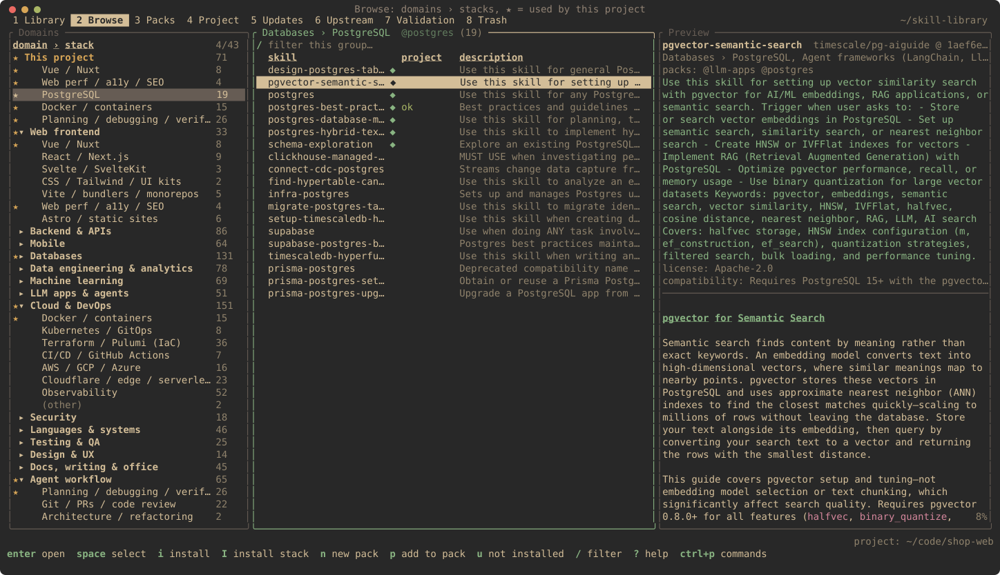
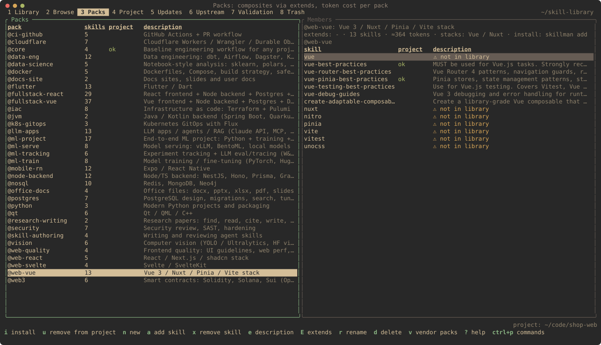
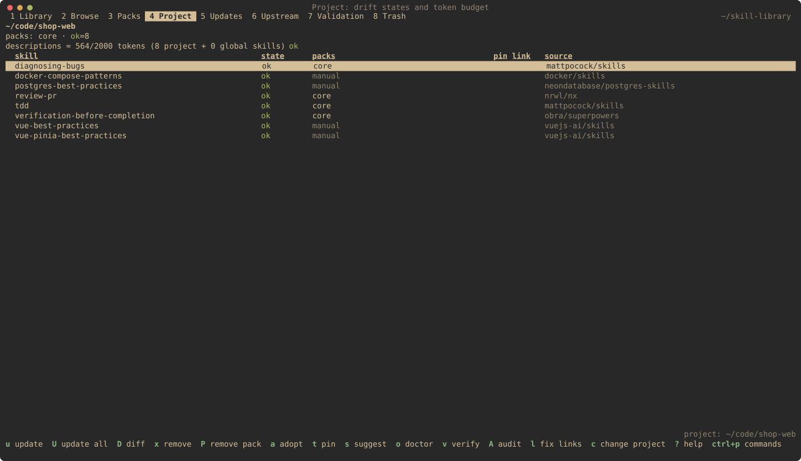

<div align="center">

# skillman

A fast terminal UI and CLI for curating agent skills, and giving each project only the ones it needs.

[](https://github.com/hoangisreal/skillman/actions/workflows/ci.yml)
[](go.mod)
[](LICENSE)

[Getting started](#getting-started) •
[Installation](#installation) •
[Usage](#usage) •
[Agents](#use-it-from-coding-agents) •
[Configuration](#configuration) •
[Docs](#documentation)


</div>

Skills (`SKILL.md` folders) for **Claude Code**, **Codex CLI** and **OpenCode** pile up fast. Install hundreds
globally and every session pays for their descriptions; copy them into projects and they drift from upstream.

skillman keeps them in a **cold library** that no agent reads, copies the few each project needs into it (tracked by a
manifest), and updates them only after checking what changed upstream. It is one Go binary: a TUI that stays fast on
700+ skills, and a CLI with `--json` output that your coding agents can drive.

## Getting started

```sh
skillman upstream verify && skillman upstream tick --pack core web-vue && skillman upstream import  # fill the library
cd ~/code/my-app
skillman recommend .        # what this project's stack needs, with token cost
skill-add @core @web-vue    # copy the skills in, link them for Claude Code, record them
skillman                    # browse, install, update and remove in the TUI
```

## Installation

### Download a binary

Download the archive for your CPU (`amd64` or `arm64`) and `SHA256SUMS` from the same tagged [GitHub release](https://github.com/hoangisreal/skillman/releases). Compare the SHA-256 digest of the downloaded archive with its entry in that file.

| System | Verify the download | Extract and start |
|---|---|---|
| Windows (PowerShell) | `Get-FileHash .\skillman-*.zip -Algorithm SHA256` | `Expand-Archive .\skillman-*.zip -DestinationPath .\tools` then `.\tools\skillman.exe init` |
| macOS | `shasum -a 256 skillman-*.tar.gz` | `tar -xzf skillman-*-darwin-*.tar.gz` then `./skillman init` |
| Linux | `sha256sum skillman-*.tar.gz` | `tar -xzf skillman-*-linux-*.tar.gz` then `./skillman init` |

Place the extracted executable on your PATH. Run `skillman agent-setup` to make the bundled instructions available to local agents. Run `skillman recommend -C . --brief --json` in a project or launch `skillman` for the TUI. Git is needed for GitHub imports, upstream updates and library history.

### Build from source

1. **Install the binary**

   Requires Go 1.26+ and git.

   ```sh
   git clone https://github.com/hoangisreal/skillman
   cd skillman && ./install.sh
   ```

   This builds `~/.local/bin/skillman` (with `skill-add` and `skill-search` links), creates the library in
   `~/skill-library` and links the `skillman` skill for your agents. It is idempotent and backs up any real file it
   would replace. Pass `--no-global-skill` to skip the agent link.

   <details>
   <summary>With <code>go install</code></summary>

   ```sh
   go install github.com/hoangisreal/skillman/cmd/skillman@latest
   skillman init           # create the library
   skillman agent-setup    # optional: let agents use skillman everywhere
   ```

   `skill-add` and `skill-search` are optional: `ln -s skillman "$(go env GOPATH)/bin/skill-add"` (same for
   `skill-search`).
   </details>

2. **Fill the library**

   `staging/repos.txt` lists 103 curated upstream repos. Verify them, tick what you want and import:

   ```sh
   # For a first project, preview and import just one starter pack:
   skillman bootstrap --pack web-vue --dry-run
   skillman bootstrap --pack web-vue

   # To explore the broader collection:
   skillman upstream verify -j 8                    # sparse clones, lists ~3000 candidates
   skillman upstream tick --pack core web-vue postgres
   skillman upstream tick --tier official --max-per-repo 40   # or in bulk
   skillman upstream import                         # license required, plugin wiring stripped
   ```

   You can also tick candidates in the TUI (tab 6, `space`, then `I`).

3. **Hook up your agents** (optional)

   Done by `install.sh`. Otherwise run `skillman agent-setup`, or add the skill to a single project with
   `skill-add skillman`. See [Use it from coding agents](#use-it-from-coding-agents).

<details>
<summary>Upgrading from skillman 0.1 (Python)</summary>

Run `./install.sh` again. The library, packs, `SOURCE.json`, project manifests, trash and registry are read as they
are: the Go version reproduces their formats byte for byte. `python3 ~/skill-library/scripts/skillcore.py <cmd>`
becomes `skillman <cmd>` (old command names still work as aliases), and `skill-add` / `skill-search` keep their
syntax.
</details>

## Usage

### Search the library

`skillman` opens the TUI on the current project. Press `/` and type: results are ranked by name, then description,
and filters combine freely.

```
postgres migration      words must all match
-react                  exclude a word
stack:vue  domain:backend  pack:core  src:redis  tag:web
installed  notinstalled  nopack
```

`space` selects, `i` installs the selection, `p` adds it to a pack, `enter` opens the full SKILL.md. The same search
runs from the shell: `skillman search "postgres migration" --json`.

### Browse by domain and stack



Tab 2 sorts every skill into 16 domains and ~70 stacks (Web frontend › Vue, Databases › PostgreSQL, Cloud & DevOps ›
Docker, LLM apps › MCP, …). Stacks your project uses are marked ★ and grouped under **This project**. `I` installs a
stack's curated pack, `n` saves your selection as a new pack. From the shell: `skillman browse --stack postgres`.

Re-file a skill or add your own domains in `~/skill-library/taxonomy.yaml` ([guide](docs/taxonomy.md)).

### Add skills to a project

```sh
skillman recommend . --task "vue test" --brief --json # ranked local choices, evidence, state and added tokens
skill-add @postgres vitest --dry-run  # what would be copied and what it costs per session
skill-add @postgres vitest            # copy, link and record
```

Each skill lands in `.agents/skills/<name>/` (a real, committed copy for Codex and OpenCode), gets a link in
`.claude/skills/` for Claude Code, and is recorded with its upstream commit and content hash in
`.agents/skill-manifest.json`. Commit all three.

### Group skills into packs



A pack is a named list of skills; `extends` builds composites (`@fullstack-vue` = web-vue + node-backend + postgres +
docker). 34 starter packs ship with skillman. Edit them in tab 3 or with
`skillman pack create|add|rm|describe|extends|rename|delete`. See [packs](docs/packs.md).

### Keep project skills current



Tab 4 (or `skillman status`) shows each skill as `ok`, `outdated`, `modified`, `conflict`, `untracked`, `missing` or
`orphan`. `skillman update` refreshes outdated copies, `diff` shows what changed, `pin` keeps a deliberate local
edit, `remove` moves a copy to the trash. `doctor` checks links, shadowing and the description token budget.

### Update the library from upstream

```sh
skillman library check        # read-only: one git ls-remote per repo, tree OIDs per skill subpath
skillman library auto-safe    # apply safe updates and commit; queue the risky ones
skillman library rollback <skill>
```

An update is **risky**, and never applied automatically, if it adds hooks, a download piped to a shell, credential
reads, broader `allowed-tools` or new executables, loses its license, or would drop a local change. Review risky
ones in tab 5: `enter` shows the upstream changelog, the verdict and the full diff. See [updates](docs/updates.md).

### Check skills in CI

```yaml
- uses: actions/setup-go@v5
  with: { go-version: "1.26" }
- run: go run github.com/hoangisreal/skillman/cmd/skillman@<sha> verify .                  # committed skills match the manifest
- run: go run github.com/hoangisreal/skillman/cmd/skillman@<sha> audit . --fail-on review  # no hooks, pipe-to-shell, …
```

Neither command needs your library. See [CI](docs/ci.md) for a full workflow and a pre-commit hook.

## Use it from coding agents

`install.sh` links the [`skillman` skill](skills/skillman/SKILL.md) into `~/.claude/skills` (Claude Code, OpenCode)
and `~/.agents/skills` (Codex). Ask your agent to *"pick the skills this repo needs"* and it runs:

```sh
skillman recommend . --json
skillman search "<words>" --json
skillman info <skill> --json
skillman add @pack skill … --dry-run --json
skillman add @pack skill …                      # after you agree
skillman status --json
```

Every TUI action is a non-interactive command, read commands print stable JSON, and exit codes are `0` ok, `1`
failed, `2` usage. The skill tells agents to ask before adding many skills, editing packs or the library, and
committing. See [agents](docs/agents.md) for the JSON shapes.

## Keybindings

| Key | Action |
|---|---|
| `1`–`8` · `[` `]` | Switch tab: Library, Browse, Packs, Project, Updates, Upstream, Validation, Trash |
| `/` | Search or filter |
| `space` · `ctrl+a` · `esc` | Select · select all shown · clear |
| `enter` | Open / primary action |
| `tab` · `shift+tab` | Next / previous pane |
| `ctrl+p` | Command palette with every action |
| `?` | Help for the current tab |
| `q` | Quit |

The mouse works everywhere: click tabs, rows, the ● column and footer keys, double-click to open, scroll the pane
under the pointer, drag the preview divider. Per-tab keys are in the footer and in [commands](docs/commands.md#tui-keys).

## Configuration

| Variable | Default | |
|---|---|---|
| `SKILL_LIBRARY` | `~/skill-library` | The library (its own git repository) |
| `SKILLMAN_STATE` | `~/.local/state/skillman` | Project registry and trash |
| `SKILL_TOKEN_BUDGET` | `2000` | Description tokens per session before `doctor` warns |
| `SKILLCORE_GIT_BASE` | `https://github.com/` | Where `owner/repo` upstreams are fetched from |
| `SKILLMAN_TRACE` | | File to log the duration of every TUI update and frame |

| File | |
|---|---|
| `~/skill-library/packs/*.yaml` | Your packs |
| `~/skill-library/taxonomy.yaml` | Domain and stack overrides ([guide](docs/taxonomy.md)) |
| `~/skill-library/staging/repos.txt` | Upstream repos to import from |
| `contrib/systemd/` | Optional weekly `library auto-safe` timer |

## Performance

Measured on a 718-skill library, median per key:

| | 0.1 (Python, Textual) | 0.2 (Go, Bubble Tea) |
|---|---|---|
| Start-up | 1.3 s | 24 ms |
| Keystroke in search | 80 ms | 1.1 ms |
| Cursor move with preview | 413 ms | 1.5 ms |

How: [architecture › performance design](docs/architecture.md#performance-design).

## Documentation

- [Commands and keys](docs/commands.md)
- [Domains, stacks and taxonomy.yaml](docs/taxonomy.md)
- [Using skillman from agents](docs/agents.md)
- [Packs](docs/packs.md)
- [Upstream updates and safety gates](docs/updates.md)
- [CI](docs/ci.md)
- [Architecture](docs/architecture.md)

## FAQ

<details>
<summary>Why copy skills into projects instead of linking the library?</summary>

A project must behave the same for a teammate and in CI, so its skills are committed with it. The manifest hash is
what keeps those copies manageable: drift is visible, updates are deliberate, local edits can be pinned.
</details>

<details>
<summary>Does it modify upstream skills?</summary>

Only mechanically, and each change is recorded in `local_modifications`: the frontmatter `name` is set to the folder
name (only that line), a leading license comment moves below the frontmatter, in-repo symlinks are inlined and plugin
wiring (hooks, commands, MCP configs) is stripped. The upstream license is kept next to each skill.
</details>

<details>
<summary>Will it delete my files?</summary>

No. Removing a skill, replacing a modified copy or deleting a pack moves it to a trash you can restore from
(`skillman trash list`, tab 8). Library changes are git commits. Only `skillman trash empty --yes` deletes.
</details>

<details>
<summary>Does it run on Windows?</summary>

New Windows projects keep a managed Claude copy alongside the canonical `.agents/skills` tree. Both directories and `.agents/skill-manifest.json` belong in version control. Windows does not need Developer Mode for this layout. On another OS, Skillman follows the layout saved in the manifest. For an older project, preview `skillman repair-links -C . --mode copy --dry-run` and rerun without `--dry-run` to convert tracked links.

Commit the generated `.gitattributes` in each managed skills directory to preserve file bytes across Git checkouts. Skillman preserves existing attributes files. For a repository with custom attributes, ensure these rules apply and ignore `.agents/.skillman.lock` in `.gitignore`.

```gitattributes
.agents/skills/** -text
.claude/skills/** -text
```
</details>

## Alternatives

- [vercel-labs/skills](https://github.com/vercel-labs/skills): installer for 75+ agents, with a lockfile and the
  [skills.sh](https://skills.sh) directory.
- [`gh skill`](https://github.blog/changelog/2026-04-16-manage-agent-skills-with-github-cli/): skills from the GitHub CLI.
- [Skills Manager](https://github.com/xingkongliang/skills-manager): desktop app with a central repo and presets.

Pick skillman if you keep a large private collection and want to control, and review, what reaches each project.

## Contributing

Issues and pull requests are welcome. `go vet ./... && go test -race ./...` runs the whole offline suite; see
[CONTRIBUTING](CONTRIBUTING.md).

## License

The tooling is [MIT](LICENSE). Skills are not distributed here: each import keeps its upstream license and
provenance, and unlicensed skills are refused.
