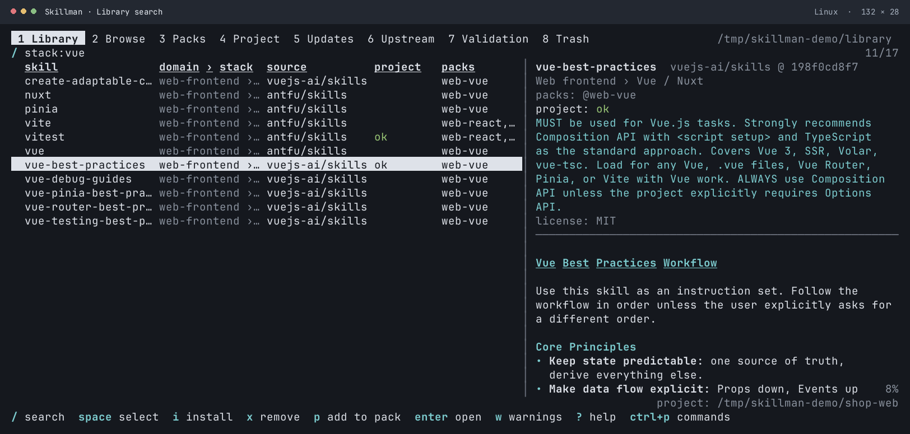
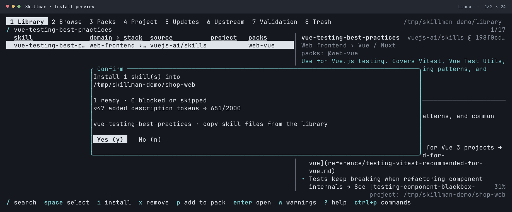

# Skillman

**Manage agent skills per project.**

Skillman provides a CLI and terminal UI to find, install, and update agent skills from a local library. Each skill is a folder with instructions in `SKILL.md`. Teams can commit the skills they choose, review changes in Git, and verify the same files in CI.

[](https://github.com/hoangisreal/skillman/actions/workflows/ci.yml)
[](https://github.com/hoangisreal/skillman/actions/workflows/packages.yml)
[](LICENSE)

[Install](#install) · [Quickstart](#quickstart) · [Terminal UI](#terminal-ui) · [Use with coding agents](#use-with-coding-agents) · [Documentation](#documentation)



## Install

For Linux, macOS, or Windows PowerShell, install **Go 1.26+** and **Git**, then run these commands.

```sh
go install github.com/hoangisreal/skillman/cmd/skillman@main
skillman --version
```

If your shell cannot find `skillman`, run `go env GOBIN GOPATH`. Add the `GOBIN` directory to your `PATH`. If `GOBIN` is blank, use the `bin` directory inside `GOPATH`.

<details>
<summary>Install from a clone on Linux or macOS</summary>

```sh
git clone https://github.com/hoangisreal/skillman
cd skillman
./install.sh --no-global-skill
```

The installer builds into `~/.local/bin`, adds the `skill-add` and `skill-search` shortcuts, and initializes the library. Add `~/.local/bin` to your `PATH`. If your macOS version lacks `readlink -f`, use `go install` above.

</details>

<details>
<summary>Use a prebuilt binary</summary>

Sign in to GitHub, open a successful run on `main`, and download `packages` from **Artifacts**. The bundle has archives for Linux, macOS, and Windows on `amd64` and `arm64`. [Portable packages runs](https://github.com/hoangisreal/skillman/actions/workflows/packages.yml?query=branch%3Amain)

Unzip the bundle and compare the digest of your chosen archive with `SHA256SUMS`. Use `sha256sum <archive>` on Linux, `shasum -a 256 <archive>` on macOS, or `Get-FileHash <archive> -Algorithm SHA256` in PowerShell.

Extract the verified archive, put the executable on your `PATH`, and run `skillman --version`. Keep Git available for imports and library history.

</details>

## Quickstart

### 1. Populate your library

`init` creates `~/skill-library` with pack definitions and the bundled Skillman instructions. A pack groups related skills. The `core` pack covers testing, debugging, verification, and code review.

```sh
skillman init
skillman bootstrap --pack core --dry-run
```

Review the sources and pinned commits. Then import the starter skills into your library.

```sh
skillman bootstrap --pack core
```

### 2. Install one skill in an empty project

Create a folder for the example, or open the directory of an existing project. Add `-C <project-dir>` to target it from another directory.

```sh
mkdir my-app
cd my-app
skillman recommend --brief
skillman add tdd --dry-run
```

`recommend` uses the local library. It detects stacks from project files when available and uses `core` when an empty folder has no stack signals. The install preview shows what will happen to each skill and estimates the description token cost.

When the preview shows `copy` for `tdd`, apply and check the result.

```sh
skillman add tdd
skillman verify .
```

A new install prints `✓ tdd: ok` during verification. To preview all members of the pack, run `skillman add '@core' --dry-run`.

### 3. Share the selected skills with your team

Commit `.agents/skills/`, `.agents/skill-manifest.json`, and `.claude/skills/`, including any generated `.gitattributes` files. The manifest records the upstream commit and content hash for each managed skill. Teammates receive those files with a Git checkout and can verify them with the Skillman binary.

If your team uses Windows, follow the [mixed-platform setup](#windows-and-mixed-platform-teams) before committing the Claude skill paths. Keep `.agents/.skillman.lock` in your project's `.gitignore`.

## Terminal UI

Run `skillman` from your project. Press `/` to search, `Space` to select, and `i` to preview the installation. Use `2` to browse by stack, `4` to inspect the project, and `?` for shortcuts.



The Project tab shows what is installed, how it differs from the library, and how much description space it uses. [Project tab screenshot](docs/screenshots/4-project.png) · [All screenshots](docs/screenshots) · [Keyboard shortcuts](docs/commands.md#tui-keys)

## Import a skill and recommend it by stack

For a Vue project, start by inspecting a source and previewing a single skill. A GitHub import goes into your local library. Add `-C .` when you also want to install the skill in the current project.

```sh
skillman import vuejs-ai/skills --list
skillman import vuejs-ai/skills --skill vue-testing-best-practices --dry-run --json
```

Imports require an upstream license. Check the preview for audit findings, then replace `REVIEWED_SHA` with the reported `commit`. In scripts, you can pass the returned `apply_args` to `skillman`.

```sh
skillman import vuejs-ai/skills --skill vue-testing-best-practices --commit REVIEWED_SHA
skillman recommend --stack vue --task "testing" --brief
```

Declare a stack with `--stack` even before files like `package.json` exist. Run `skillman taxonomy` to list IDs, and repeat `--stack` for a project that uses more than one. Use `skillman add <name> --dry-run` to preview a recommendation. [Bulk import and audit options](docs/commands.md#import-pipeline)

## Use with coding agents

Skillman places project skills in `.agents/skills/` and provides a link or managed copy in `.claude/skills/`. Run `skillman status --agents` to inspect standard locations for Claude Code, Codex CLI, Cursor, GitHub Copilot CLI, and OpenCode. Add `--include-global` to check personal directories for duplicates.

To teach clients how to use Skillman itself, run `skillman agent-setup` for your user account or `skillman add skillman` for one project. Try asking your agent for a shortlist.

> Find skills in my local Skillman library for writing tests. Show me the shortlist and the estimated description tokens before installing anything.

[Agent setup and JSON output](docs/agents.md)

## Daily commands

| Task | Command |
| --- | --- |
| Find or inspect skills | `skillman search "vue testing"` or `skillman info tdd --body` |
| Inspect a pack | `skillman pack show core` |
| Check the project and its description budget | `skillman status` and `skillman doctor` |
| Check upstream changes to your library | `skillman library check` |
| Preview and refresh project copies | `skillman update --dry-run`, then `skillman update` |
| Remove or recover a skill | `skillman remove tdd`, then `skillman trash list -C .` and `skillman trash restore <id> -C .` |
| Verify tracked files in CI | `skillman verify .` |
| Audit skill files in CI | `skillman audit . --fail-on review` |

Library updates bring in newer copies from upstream. Project updates copy reviewed library versions into a specific project. Verification and audit run offline with the binary and project files. [Update and rollback guide](docs/updates.md) · [CI workflow example](docs/ci.md)

## Windows and mixed-platform teams

Skillman uses physical copies for Claude in new Windows projects. These work without Developer Mode. On Linux and macOS, the default is a relative symlink. For a shared project that already has symlinks, convert them on a checkout with working links.

```sh
skillman repair-links -C . --mode copy --dry-run
```

After reviewing the listed paths, convert and verify.

```sh
skillman repair-links -C . --mode copy
skillman verify .
```

Commit the converted folders, manifest, and generated `.gitattributes`. If you manage Git attributes yourself, ensure `-text` applies to `.agents/skills/**` and `.claude/skills/**` so Git preserves the bytes that `verify` hashes. [Portable checkout tests](https://github.com/hoangisreal/skillman/actions/workflows/packages.yml)

## Configuration

| Environment variable | Default | Controls |
| --- | --- | --- |
| `SKILL_LIBRARY` | `~/skill-library` | Local skills, packs, and upstream sources |
| `SKILLMAN_STATE` | `~/.local/state/skillman` | Project registry and trash |
| `SKILL_TOKEN_BUDGET` | `2000` | Description token budget reported by `doctor` |

## Documentation

- [Commands and keyboard shortcuts](docs/commands.md)
- [Agent setup and automation](docs/agents.md)
- [Create and combine skill packs](docs/packs.md)
- [Customize domains and stacks](docs/taxonomy.md)
- [Review upstream updates and roll back](docs/updates.md)
- [Verify and audit skills in CI](docs/ci.md)
- [Architecture and on-disk formats](docs/architecture.md)
- [Recommendation evaluation and benchmarks](docs/selection-evaluation.md)

<details>
<summary>Upgrade from Skillman 0.1 (Python)</summary>

Run `./install.sh` again. The Go version reads your existing library, packs, manifests, trash and registry. Replace `python3 ~/skill-library/scripts/skillcore.py <command>` with `skillman <command>`. The legacy `skill-add` and `skill-search` shortcuts keep their syntax.

</details>

## Contributing and license

See the [contributing guide](CONTRIBUTING.md) for local setup and tests. Skillman is [MIT licensed](LICENSE). Imported skills retain their upstream licenses and provenance.
