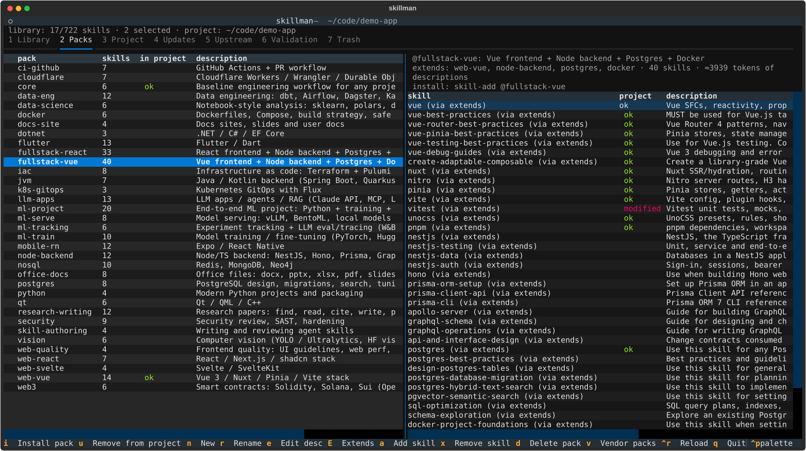
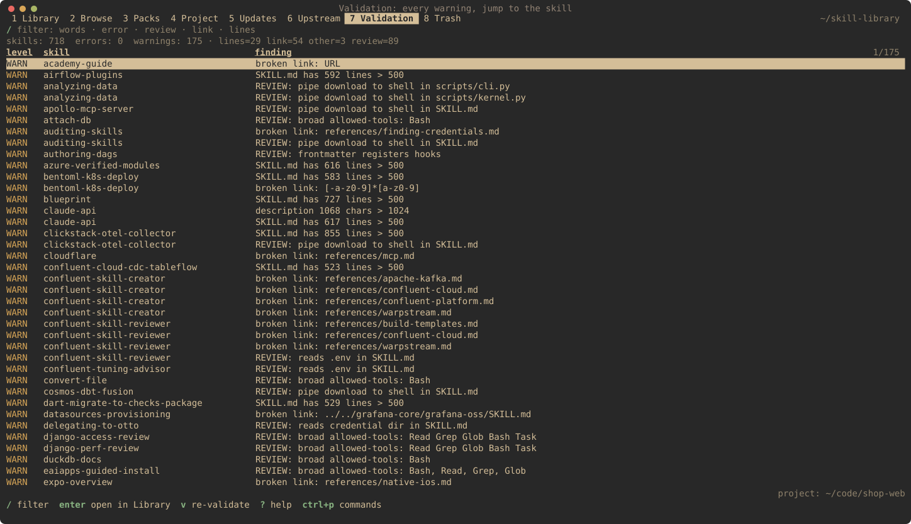

<div align="center">

# skillman

**Curate agent skills once. Give each project only the ones it needs. Update them without trusting upstream blindly.**

A cold skill library, per-project packs, safe upstream updates and a terminal UI for
**Claude Code**, **OpenAI Codex CLI** and **OpenCode**.

[](https://github.com/hoangisreal/skillman/actions/workflows/ci.yml)


[](LICENSE)

[Quick start](#quick-start) · [Commands](#commands) · [Safe updates](#safe-updates) · [CI](#use-it-in-ci) ·
[Compare](#how-it-compares) · [FAQ](#faq) · [Docs](#documentation)


</div>

## Why skillman

Agent skills (`SKILL.md` folders) work well while you have a dozen. With hundreds, three problems show up:

- **Context bloat.** Every globally installed skill puts its name and description into *every* session. 700 skills
  are tens of thousands of tokens before you type anything, and Codex gives skill descriptions a fixed token budget.
- **Drift.** A skill copied into a project rots when upstream fixes it, and re-copying wipes your local tweaks.
- **Supply chain.** Skill repos ship hooks, pipe-to-shell installers, MCP configs and symlinks. Pulling "latest" means
  running someone else's code inside your agent.

skillman keeps every skill in a **cold library** that no agent scans. Each project gets **real, committed copies** of
the handful it needs, tracked by a **manifest**, so drift is visible and every update is a reviewed, reversible
change.

## Quick start

```bash
git clone https://github.com/hoangisreal/skillman && cd skillman && ./install.sh

# fill the library from 103 curated upstream repos (license required, plugin wiring stripped)
python3 ~/skill-library/scripts/verify-repos.py -j 8
python3 ~/skill-library/scripts/tick-candidates.py --pack core web-vue postgres
python3 ~/skill-library/scripts/import-skills.py

# use it
cd ~/code/my-app
skill-add --suggest .          # → @core @web-vue @docker @ci-github …
skill-add @core @web-vue       # copy + link + record in .agents/skill-manifest.json
skillman                       # manage everything in the TUI
```

You need Python 3.11+ with PyYAML, and git. The TUI runs through [uv](https://docs.astral.sh/uv/)
(`uv run --script`, Textual pinned by `bin/skillman.lock`), so nothing is installed into your system Python.
`install.sh` is idempotent and never overwrites a real file.

## Features

| | |
|---|---|
| 📦 **Packs** | Named groups (`@web-vue`, `@postgres`, `@ml-train`, …) with `extends` for composites: `@fullstack-vue` is web-vue + node-backend + postgres + docker. 34 starter packs ship with the tool; vendor packs such as `@vendor/trailofbits` are generated. |
| 🎯 **One command per project** | `skill-add @core @web-vue vitest` copies, links and records. `--suggest` reads `package.json`, `pyproject.toml`, `go.mod`, `pom.xml`, `*.csproj`, `pubspec.yaml`, `Dockerfile`, `*.tf` and workflows, then proposes packs. |
| 🖥️ **TUI** | 7 tabs: Library, Packs, Project, Updates, Upstream, Validation and Trash. Everything the TUI does is also a CLI command. |
| 🔄 **Upstream updates** | Check the whole library, one pack or a few skills. Compares the **git tree OID of each skill's subpath** without downloading blobs: about 600 skills across 60+ repos in seconds. Shows the changelog and diff, applies atomically, commits the library, and `rollback` undoes it. |
| 🛡️ **Risk gates** | An update is **risky**, and never auto-applied, if it adds hooks, pipe-to-shell patterns, credential reads, broader `allowed-tools` or new executables, loses its license, or would drop a local change. |
| 🧭 **Drift detection** | Each project skill is `ok`, `outdated`, `modified`, `conflict`, `untracked`, `missing` or `orphan`. Pinned skills are skipped by updates. |
| ✅ **CI gates** | `verify` fails a PR whose committed skills drift from the manifest, like a frozen lockfile. `audit` is an offline risk scan with `--fail-on`. Neither needs the library. |
| 🤖 **Agent-operable** | Ships a `skillman` skill, so Claude Code or Codex manage skills through the tools instead of copying folders around. |
| 🧮 **Token budget** | `doctor` estimates the description tokens that project and global skills inject per session, and flags shadowing and broken links. |
| ♻️ **Nothing is deleted** | Removed copies and deleted packs go to a restorable trash. The library is a git repo. |

## Commands

| Command | Description |
|---|---|
| `skill-add @pack name … [dir]` | Add skills and packs to a project |
| `skill-add --suggest .` · `--packs` · `--list` | Suggest packs, list packs, list skills |
| `skill-search <words>` | Search names and descriptions |
| `skillcore.py status .` · `doctor .` | Drift states · health check |
| `skillcore.py update -C .` · `diff -C . <name>` | Refresh outdated copies · see what changed |
| `skillcore.py uninstall -C . <name\|@pack>` | Remove (to trash; skills shared with other packs stay) |
| `skillcore.py verify .` · `audit .` | CI checks: frozen manifest · offline risk scan |
| `skillcore.py new <name>` | Scaffold your own skill in the library |
| `skillcore.py update-library --check [--pack P] [names]` | Read-only upstream check |
| `skillcore.py update-library --auto-safe` | Apply safe updates, queue the risky ones |
| `skillcore.py rollback <name>` | Undo a library update and pin the skill |

`skillcore.py` lives in `~/skill-library/scripts/`. See the [full command and key reference](docs/commands.md).

## Screenshots

| Packs: composites via `extends`, token cost per pack | Project: drift states and token budget |
|---|---|
|  |  |
| **Updates: tree-OID check across every upstream** | **Upstream: tick verified candidates, dry-run import** |
|  |  |
| **Update review: changelog, risk verdict, full diff** | **Validation: every warning, jump to the skill** |
|  |  |

The screenshots are rendered headlessly from a copy of a real 722-skill library by `tools/make_screenshots.py`.

## How it works

```
upstream repos ──verify──▶ candidates ──import (gates)──▶ ~/skill-library   (cold: no agent scans it)
                                                            │  skills/ · packs/ · git history
                             skill-add @web-vue @postgres ──┘
                                                            ▼
                    your-project/.agents/skills/<skill>/              real copy, committed (Codex, OpenCode)
                    your-project/.claude/skills/<skill> → ../../.agents/skills/<skill>    (Claude Code)
                    your-project/.agents/skill-manifest.json          packs, source commit, content hash, pins
```

The manifest records each skill's source commit and a content hash. Comparing the recorded hash with the project
copy's and the library's tells skillman whether a skill is current, outdated, edited locally or both.
More in [architecture](docs/architecture.md).

## Safe updates

1. Each library skill has a `SOURCE.json` with its repo, subpath and **pinned commit**.
2. `--check` runs one `git ls-remote` per repo. Only when HEAD moved does it fetch commits and trees
   (`--filter=blob:none`, cached), then compare `<old>:<subpath>` with `<new>:<subpath>` by tree ID.
3. Changed skills are rebuilt at the new commit through the import pipeline and **assessed against the current copy**.
   New risk signals make the update `risky`.
4. Safe updates are swapped in atomically and committed to the library. Risky ones wait for review in the Updates
   tab. Projects are only marked `outdated`; they change when you say so.

The [updates guide](docs/updates.md) lists every gate. A weekly systemd timer for `--auto-safe` is included but not
enabled.

## Use it in CI

```yaml
- run: pip install pyyaml && curl -fsSLo skillcore.py https://raw.githubusercontent.com/hoangisreal/skillman/<sha>/scripts/skillcore.py
- run: python skillcore.py verify .                    # committed skills match the manifest
- run: python skillcore.py audit . --fail-on review    # no hooks, pipe-to-shell, credential reads…
```

The [CI guide](docs/ci.md) has a complete GitHub Actions workflow and a pre-commit hook.

## Let your agents use it

`install.sh` puts a [`skillman` skill](skills/skillman/SKILL.md) into your library. Add it to a project with
`skill-add skillman`. Your agent then answers "which skills does this repo have?" or "add the Postgres skills" by
running `skill-add`, `status`, `doctor` and `audit`, which keeps the manifest correct. It asks you before changing the
library.

## How it compares

The skills ecosystem has excellent installers. skillman sits on a different axis: a curated, local, versioned library
with update review. Comparison based on each project's README, November 2026:

| | **skillman** | [vercel-labs/skills](https://github.com/vercel-labs/skills) | [`gh skill`](https://github.blog/changelog/2026-04-16-manage-agent-skills-with-github-cli/) | [Skills Manager](https://github.com/xingkongliang/skills-manager) |
|---|---|---|---|---|
| Interface | TUI + CLI | CLI | CLI | Desktop app + CLI |
| Agents | Claude Code, Codex, OpenCode | 75+ | 6 hosts | 50+ |
| Local, git-versioned library | ✅ cold, never scanned | — | — | ✅ central repo |
| Named groups | Packs with `extends` | Experimental, via `package.json` | — | Presets |
| Per-project record with content hash | ✅ manifest | ✅ `skills-lock.json` | Provenance in frontmatter | — |
| Change detection | Tree OID per skill subpath | Lock hash | Tree SHA | Update tracking |
| Updates assessed against the current copy | ✅ risky ones are never auto-applied | — | Preview before install | Upstream diff in app |
| CI frozen check | `verify` | `install --frozen-lockfile` | — | — |
| Context-budget check | `doctor` | — | — | — |
| Marketplace / discovery | Curated list of 103 repos | [skills.sh](https://skills.sh) | `gh skill search` | Marketplace |

**Pick something else if** you need many agents beyond these three, a public marketplace, Windows, or multi-device
sync. Those tools do it well. skillman is for people who keep a large private collection and want to control what
reaches each project.

## FAQ

<details>
<summary><b>Why copy skills into projects instead of symlinking the library?</b></summary>

A project has to behave the same for a teammate and in CI, so its skills are committed with it. The manifest hash is
what keeps those copies manageable: you see drift, update on purpose and pin deliberate edits.
</details>

<details>
<summary><b>Why not install everything globally?</b></summary>

Every global skill's description is loaded into every session, whatever you work on. Agents also choose skills
better from a short, relevant list. Keep global skills to a tiny universal core and put the rest per project.
`doctor` shows the budget.
</details>

<details>
<summary><b>Does it modify upstream skills?</b></summary>

Only mechanically, and every change is recorded in `local_modifications`: it fixes the frontmatter `name` to match
the folder, moves a license comment below the frontmatter, inlines in-repo symlinks and strips plugin wiring. The
upstream license is kept next to each skill.
</details>

<details>
<summary><b>Can I use it without the TUI or uv?</b></summary>

Yes. `skill-add` and `skillcore.py` need only Python and PyYAML. The TUI is a view on the same functions.
</details>

<details>
<summary><b>Will it ever delete my files?</b></summary>

No. Uninstalling, replacing a modified copy or deleting a pack moves things to a trash you can restore from
(`skillcore.py trash list`). Library changes are git commits. Only `trash empty --yes` deletes.
</details>

<details>
<summary><b>Is the skill library published?</b></summary>

No. This repository contains only the tooling (MIT). Skills are fetched from their upstream repositories, each with
its own license, into your local library.
</details>

## Documentation

- [Commands and TUI keys](docs/commands.md)
- [Packs](docs/packs.md): format, starter packs, vendor packs, suggestions, budget
- [Upstream updates and safety gates](docs/updates.md)
- [Using skillman in CI](docs/ci.md)
- [Architecture](docs/architecture.md): layouts, manifest format, design decisions
- [Contributing](CONTRIBUTING.md) · [Security](SECURITY.md) · [Changelog](CHANGELOG.md)

## Testing

```bash
uv run --no-project --with pyyaml python tests/test_skillcore.py                 # 93 checks: packs, projects, updates, gates
uv run --no-project --with textual==8.2.8 --with pyyaml python tests/test_tui.py # TUI driven key by key
uvx ruff@0.8.4 check .
```

Fully offline. The tests run against a fake upstream git repo served over `file://`. CI runs them on Python 3.11–3.13.

## License

The tooling is [MIT](LICENSE). Skills are **not** distributed here. They come from their upstream repositories, each
import keeps the upstream license and provenance, and unlicensed skills are refused. Check the licenses before you
redistribute your own library.
