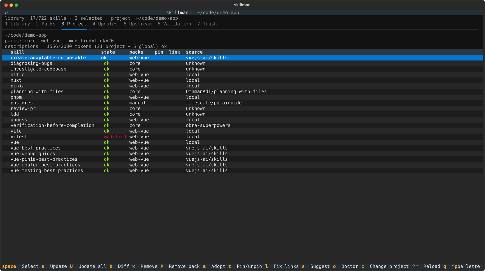
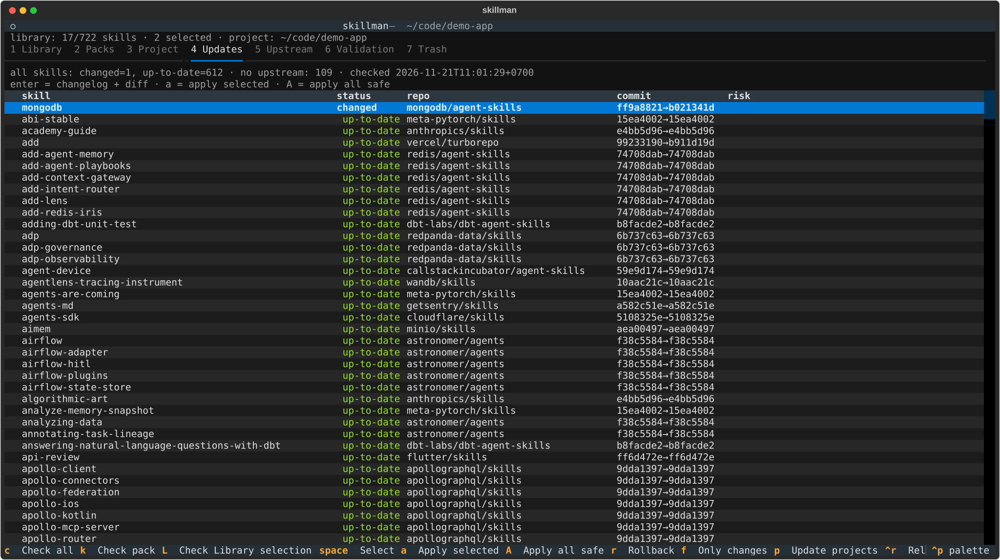
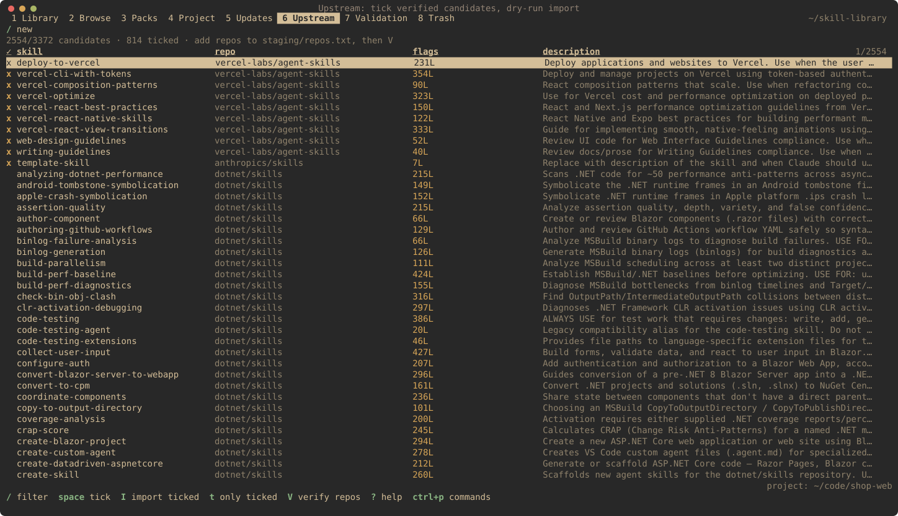
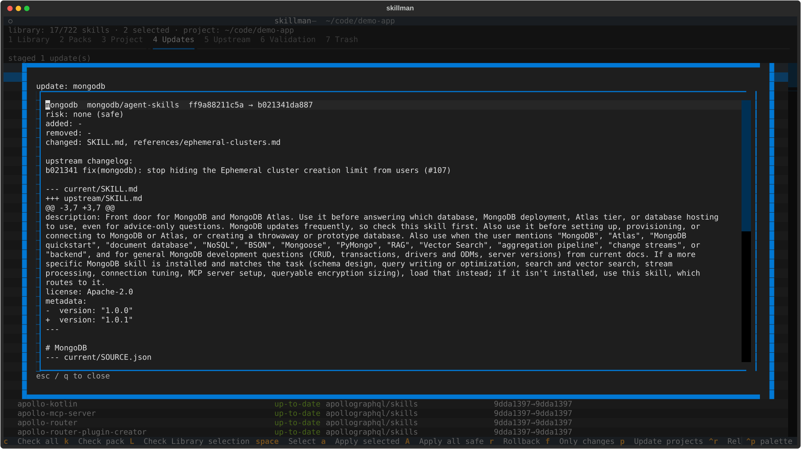

<div align="center">

# skillman

**A cold skill library for AI coding agents — curate once, inject per project, update safely.**

Works with the shared Agent Skills layout used by **Claude Code**, **OpenAI Codex CLI** and **OpenCode**.

[](https://github.com/hoangisreal/skillman/actions/workflows/ci.yml)


</div>

---

## The problem

Agent skills (`SKILL.md` folders) are great until you have hundreds of them:

- **Context bloat.** Every globally installed skill's name + description is loaded into *every* session. 700 skills ≈ tens of thousands of tokens before you type anything; Codex even has a dedicated skill-context token budget.
- **Drift.** You copy a skill into a project, upstream fixes it, your copy rots. Or you tweak it locally and a re-copy wipes your change.
- **Supply chain.** Third-party skill repos ship hooks, `curl | sh` installers, MCP configs and symlinks. Pulling "latest" blindly is running someone else's code in your agent.

## The approach

```
upstream repos ──verify──▶ candidates ──import (gates)──▶  ~/skill-library  (cold: never scanned by any agent)
                                                              │  skills/ · packs/ · git history
                              skill-add @web-vue @postgres ───┘
                                                              ▼
                       your-project/.agents/skills/<skill>/        ← real copy, committed (Codex, OpenCode)
                       your-project/.claude/skills/<skill> → ../../.agents/skills/<skill>   (Claude Code)
                       your-project/.agents/skill-manifest.json    ← packs, source commit, content hash, pins
```

Keep everything in a **cold library** no agent scans. Each project gets only the handful of skills it needs, as
**real committed copies** (teammates and CI get the same skills), tracked by a **manifest** so drift is detectable and
updates are a deliberate, reviewable action.

## Features

| | |
|---|---|
| 📦 **Packs** | Named groups of skills (`@web-vue`, `@postgres`, `@ml-train`, …) with `extends` for composites (`@fullstack-vue` = web-vue + node-backend + postgres + docker). 34 starter packs included; vendor packs (`@vendor/redis`) are generated automatically. |
| 🎯 **One command per project** | `skill-add @core @web-vue vitest` copies, links and records everything. `skill-add --suggest .` reads `package.json`, `pyproject.toml`, `go.mod`, `pom.xml`, `*.csproj`, `pubspec.yaml`, `Dockerfile`, `*.tf`, workflows… and proposes packs. |
| 🖥️ **TUI** | `skillman` — 7 tabs: Library (search, filters, Markdown preview, multi-select), Packs (create/edit/rename/extends), Project (status, diff, update, pin, adopt, doctor), Updates, Upstream, Validation, Trash. |
| 🔄 **Upstream updates** | Check the whole library, one pack, or hand-picked skills. Compares the **git tree OID of each skill's subpath** — no blobs downloaded, ~600 skills across 60+ repos in ~6 s. Shows changelog + diff, applies atomically, **auto-commits** the library, `rollback` restores and pins. |
| 🛡️ **Safety gates** | An update is **risky** (never auto-applied) if it adds hooks, `curl\|sh`-style patterns, broader `allowed-tools`, new scripts/executables, loses its license, fails validation, or would drop a manual local change. Plugin wiring (`hooks/`, `commands/`, subagents, `.mcp.json`) is never imported. Upstream symlinks are inlined only if they stay inside the repo — never followed to your filesystem. |
| 🧭 **Drift detection** | Per project skill: `ok` · `outdated` (library newer) · `modified` (edited in project) · `conflict` (both) · `untracked` (adopt it) · `missing` · `orphan`. Pinned skills are skipped by updates. |
| 🧮 **Token budget** | `doctor` estimates the description tokens your project + global skills inject per session and warns past the budget. Also flags name shadowing against global skill dirs, broken links, manifest drift. |
| ♻️ **Nothing is deleted** | Removing or replacing a project skill moves it to a trash you can browse and restore. Pack deletions too. Library history lives in git. |
| ⏰ **Optional automation** | A systemd user timer runs `update-library --auto-safe` weekly: safe updates land (and are committed), risky ones wait in the Updates tab. |

## Quick start

```bash
git clone https://github.com/hoangisreal/skillman && cd skillman
./install.sh                                   # links skillman / skill-add / skill-search into ~/.local/bin,
                                               # bootstraps ~/skill-library (override with SKILL_LIBRARY=...)

# 1. Find skills: verify the curated upstream list (103 repos, read-only sparse clones)
python3 ~/skill-library/scripts/verify-repos.py -j 8

# 2. Pick what you want — by pack, by repo, or tick by hand (or in the TUI, tab 5)
python3 ~/skill-library/scripts/tick-candidates.py --pack core web-vue postgres
python3 ~/skill-library/scripts/import-skills.py --dry-run
python3 ~/skill-library/scripts/import-skills.py && python3 ~/skill-library/scripts/validate-library.py

# 3. Use them
cd ~/code/my-app
skill-add --suggest .                          # → @core @web-vue @docker @ci-github …
skill-add @core @web-vue
skillman                                       # manage interactively
```

Requirements: Python ≥ 3.11 with PyYAML, git. The TUI runs through [uv](https://docs.astral.sh/uv/)
(`uv run --script`, Textual pinned by `bin/skillman.lock`) — nothing is installed into your system Python.

## Screenshots

| Packs — composites via `extends`, token cost per pack | Project — drift states, token budget |
|---|---|
|  |  |
| **Updates — tree-OID check across every upstream** | **Upstream — tick verified candidates, dry-run import** |
|  |  |
| **Update review — upstream changelog, risk verdict, full diff** | **Validation — every warning, jump to the skill** |
|  |  |

Screenshots are rendered headlessly from a copy of a real 722-skill library by `docs/make_screenshots.py`.

## Command reference

Everything the TUI does is also a CLI: `python3 ~/skill-library/scripts/skillcore.py <command>`.

| Task | Command |
|---|---|
| Add skills / packs to a project | `skill-add @core @web-vue vitest [dir]` · `skill-add -C dir … --force` |
| List / search | `skill-add --packs` · `skill-add --list` · `skill-search postgres migration` |
| Suggest packs for a repo | `skill-add --suggest .` |
| Project status · health | `skillcore.py status .` · `skillcore.py doctor .` |
| Refresh outdated copies · diff | `skillcore.py update -C . [names] [--force]` · `skillcore.py diff -C . <name>` |
| Remove skills / a whole pack | `skillcore.py uninstall -C . <name> @<pack>` (shared skills are kept) |
| Track pre-existing copies · pin | `skillcore.py adopt -C .` · `skillcore.py pin -C . <name>` |
| Check upstream (all / pack / some) | `skillcore.py update-library --check [--pack web-vue] [names…] [--log]` |
| Apply safe updates · everything | `skillcore.py update-library --auto-safe` · `--apply [--allow-risky]` |
| Push library updates into projects | `skillcore.py update-projects [--dry-run]` |
| Undo a library update | `skillcore.py rollback <name>` (restores previous git version and pins it) |
| Trash | `skillcore.py trash list \| restore <id> \| empty --yes` |
| Packs from your library | `scripts/build-packs.py` (vendor packs regenerate; your stack packs are never overwritten) |

### TUI keys

`1`–`7` switch tabs · `/` search · `space` multi-select · `q` quit · `ctrl+p` command palette.
Library: `i` install · `p` add to pack · `w` warnings. Packs: `i` install · `u` remove from project · `n` new · `r` rename ·
`e`/`E` description/extends · `a`/`x` add/remove skill · `d` delete. Project: `u`/`U` update · `D` diff · `x` remove ·
`P` remove pack · `a` adopt · `t` pin · `l` fix links · `s` suggest · `o` doctor · `c` change project. Updates: `c` check all ·
`k` check pack · `L` check Library selection · `enter` changelog + diff · `a` apply selected · `A` apply all safe · `r` rollback ·
`p` update projects. Upstream: `space` tick · `I` import (dry-run first). Trash: `R` restore · `D` diff · `x`/`E` delete.

## How updates work

1. Every imported skill carries `SOURCE.json`: repo, subpath, **pinned commit**, local modifications.
2. `check` runs one `git ls-remote` per repo. If HEAD moved, it fetches commits + trees only (`--filter=blob:none`,
   persistent cache in `.cache/repos`) and compares `rev-parse <old>:<subpath>` vs `<new>:<subpath>`.
   Unchanged subpaths cost nothing; removed subpaths and vanished licenses are reported.
3. A changed skill is **materialized** at the new commit into a staging dir with the same import pipeline
   (license required, plugin wiring stripped, mechanical fixes re-applied), then **assessed** against the current
   copy by the validator. New risk signals → `risky`.
4. `apply` swaps the directory atomically, rebuilds the index, and commits to the library repo with the old→new
   commits in the message. Projects are only *marked* `outdated`; they change when you say so.

## Layout

```
skillman/                         this repo (tooling, MIT)
├── bin/skillman                  Textual TUI (PEP 723 script + uv lock)
├── bin/skill-add, skill-search   thin CLIs
├── scripts/skillcore.py          all logic: packs, projects, trash, updates, validation (stdlib + PyYAML)
├── scripts/{verify-repos,tick-candidates,import-skills,validate-library,build-packs}.py
├── scripts/systemd/              optional weekly update timer
├── packs/                        starter packs (only skills resolvable from staging/repos.txt)
├── staging/repos.txt             curated upstream list: tier, group, owner/repo, subpath hint
└── tests/                        67 core checks + 26-step TUI pilot test, fully offline (fake git upstream)

~/skill-library/                  your data (its own git repo)
├── skills/<name>/                SKILL.md + SOURCE.json (+ UPSTREAM-LICENSE.txt)
├── packs/*.yaml, packs/vendor/   your packs
├── staging/                      candidates, verify log
├── INDEX.md|json, VALIDATION.md, IMPORT_LOG.md, UPDATE_LOG.md
└── scripts → skillman/scripts
```

## Design notes

- **Copies, not symlinks into the library.** A project must build the same way on a teammate's machine and in CI,
  so skills are committed with the project. The manifest's content hash is what makes copies manageable.
- **Cold by default.** Global skill dirs stay tiny and universal; per-project skills load only where relevant.
- **Git for history, trash for everything else.** Library changes are commits you can revert; project removals are
  moves you can restore. The tool never `rm`s user data without an explicit "empty trash".
- **Refuse rather than guess.** Symlinked `.agents/` or `.claude/skills/` dirs, real directories where a link should
  be, invalid names, path traversal in pack/skill names, dirty library working trees — all refused with a message.
- **The TUI is a view.** `skillcore.py` is importable and scriptable; the TUI and `skill-add` are thin layers on it,
  so CLI, TUI, timer and tests exercise the same code.

## Testing

```bash
uv run --no-project --with pyyaml python tests/test_skillcore.py
uv run --no-project --with textual==8.2.8 --with pyyaml python tests/test_tui.py
uvx ruff check .
```

Tests build a throwaway library plus a fake upstream (bare git repo served over `file://` with partial-clone
support) and cover: pack expansion and cycles, install/update/conflict/adopt/pin flows, trash round-trips, path
traversal and symlink refusals, tree-OID change detection, safe vs risky updates, license removal, symlink
inlining, rollback, and the TUI driven key-by-key with Textual's pilot. CI runs them on Python 3.11–3.13.

## Licensing

The tooling is MIT. **Skills are not distributed here** — they are fetched from their upstream repositories,
each import keeps the upstream license (`UPSTREAM-LICENSE.txt`) and provenance, and skills without a license are
not imported. Review licenses before redistributing your library.
