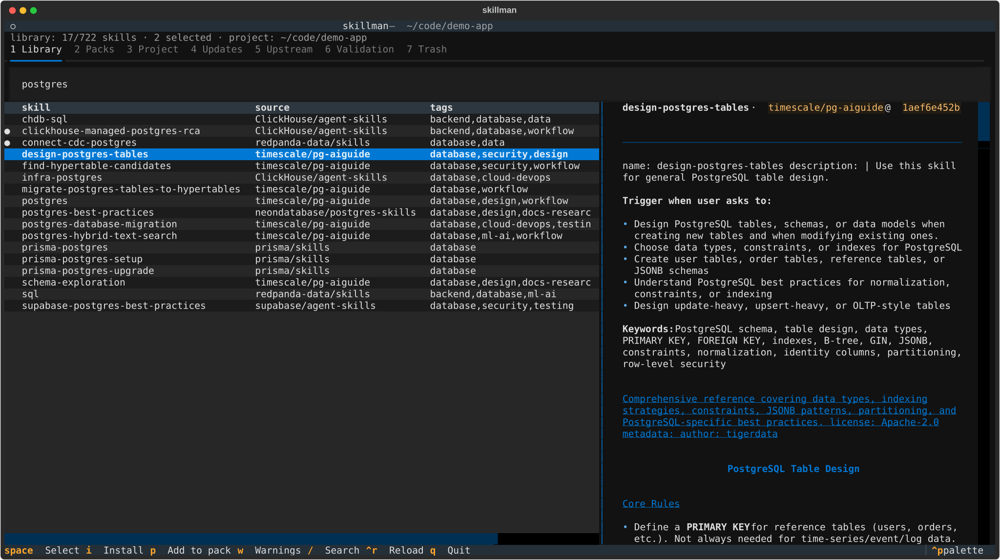

# Skillman

**Give each project the agent skills it needs.**

Skillman is a CLI and terminal UI for finding, installing, and updating agent skills. A skill is a folder with a `SKILL.md` file that teaches a coding agent a task or workflow. Skillman keeps your collection in a local library and copies selected skills into each project so your team can review, commit, and verify the same instructions.

[](https://github.com/hoangisreal/skillman/actions/workflows/ci.yml)
[](https://github.com/hoangisreal/skillman/actions/workflows/packages.yml)
[](LICENSE)

[Install](#install) · [Quickstart](#quickstart) · [Use with coding agents](#use-with-coding-agents) · [Daily commands](#daily-commands) · [Documentation](#documentation)

## Install

The commands below work on Linux, macOS, and Windows PowerShell. Install **Go 1.26 or newer** and **Git** first. Add your Go binary directory to `PATH` (`GOBIN` if set, otherwise the `bin` directory under `go env GOPATH`).

```sh
go install github.com/hoangisreal/skillman/cmd/skillman@main
skillman --version
skillman init
```

`init` creates `~/skill-library` with starter pack definitions, a list of upstream repositories, and the bundled Skillman instructions. The next step imports the actual skills.

<details>
<summary>Install from a local clone on Linux or macOS</summary>

```sh
git clone https://github.com/hoangisreal/skillman
cd skillman
./install.sh --no-global-skill
```

The installer builds into `~/.local/bin`, adds the `skill-add` and `skill-search` shortcuts, and initializes the library. Add `~/.local/bin` to `PATH`. Run `skillman agent-setup` when you want agents to discover the bundled instructions.

</details>

The [package workflow](https://github.com/hoangisreal/skillman/actions/workflows/packages.yml) builds archives for Linux, macOS and Windows. When downloading an archive from a [tagged release](https://github.com/hoangisreal/skillman/releases), compare its SHA-256 digest with the release's `SHA256SUMS`, extract the executable, add it to `PATH`, and run `skillman init`.

## Quickstart

### 1. Load a few skills into your library

A pack is a named list of related skills. Start with `core`, which covers testing, debugging, verification, and code review. The preview shows the exact sources and commits the import will use.

```sh
skillman bootstrap --pack core --dry-run
skillman bootstrap --pack core
```

### 2. Choose skills for a project

The example creates a new directory. Open your project directory to use an existing project.

```sh
mkdir my-app
cd my-app
skillman recommend -C . --brief
skillman add -C . tdd --dry-run
skillman add -C . tdd
skillman verify -C .
```

`recommend` searches your local library and uses the project's stack when it can detect it. An empty directory starts with recommendations from the local `core` pack. The install preview shows the action for each skill and the estimated cost in description tokens. A successful check prints `✓ tdd: ok`.

Once you know the stack, declare it even before you create files like `package.json`. For example, [import a Vue testing skill](#import-a-skill-from-github) into your library by omitting `-C .` from the preview. Apply the import, then run:

```sh
skillman recommend -C . --stack vue --task "testing" --brief
```

Use `skillman taxonomy` to find stack IDs. Repeat `--stack` for projects with several stacks. To preview a whole pack, run `skillman add -C . '@core' --dry-run`.

### 3. Share the project setup

Skillman copies the selected skills into `.agents/skills/`, creates a link or managed copy in `.claude/skills/`, and records the source and content hash in `.agents/skill-manifest.json`. Commit those paths, including any generated `.gitattributes` files, so teammates get the same skill files from Git. See the [Windows notes](#windows-and-mixed-platform-teams) for repositories shared across operating systems.

## Use with coding agents

Skills live in the project. Skillman can inspect their on-disk locations for Claude Code, Codex CLI, Cursor, GitHub Copilot CLI, and OpenCode.

```sh
skillman status -C . --agents
```

Add `--include-global` to check standard personal directories for other copies. To teach your agent how to use Skillman itself, run `skillman agent-setup` once. Then try this prompt from your project:

> Find skills in my local Skillman library for testing Vue components. Show me the shortlist and its token cost before installing anything.

The CLI provides JSON for recommendations, previews, and status. See [agent setup and JSON output](docs/agents.md).

## Browse in the terminal

Run `skillman` from your project to open the terminal UI. Press `/` to search, `Space` to select, and `i` to preview installation. Use `2` to browse by stack, `4` to inspect the project, or `?` for the current tab's shortcuts.



## Daily commands

| I want to… | Run |
| --- | --- |
| Find PostgreSQL migration skills | `skillman search "postgres migration"` |
| Inspect a skill before installing it | `skillman info tdd --body` |
| See what a pack contains | `skillman pack show core` |
| Check installed skills, broken links, or token budget | `skillman status` and `skillman doctor` |
| Review and apply updates to project copies | `skillman update --dry-run`, then `skillman update` |
| Check upstream changes in the library | `skillman library check` |
| Remove a project skill and find it in the trash | `skillman remove tdd`, then `skillman trash list` |

### Import a skill from GitHub

List the skills in a repository, then preview the one you want. With `-C .`, the preview also checks the project install. Omit it to import into the library only.

```sh
skillman import vuejs-ai/skills --list
skillman import vuejs-ai/skills --skill vue-testing-best-practices -C . --dry-run --json
```

Use the returned `apply_args` as arguments to `skillman` to apply the reviewed commit. Imports require an upstream license and audit the staged files. For bulk discovery, see the [upstream import commands](docs/commands.md#import-pipeline).

### Check a project in CI

```sh
skillman verify .
skillman audit . --fail-on review
```

`verify` checks the tracked files and Claude links or copies against the project manifest. `audit` checks for validation errors and patterns that warrant review. Both commands run without the library or network once the binary is installed. See the [CI workflow example](docs/ci.md).

## Windows and mixed-platform teams

New Windows projects use managed Claude copies, which work without Developer Mode. For a project already using symlinks, a teammate on a checkout with working links can preview and convert them before committing the result:

```sh
skillman repair-links -C . --mode copy --dry-run
skillman repair-links -C . --mode copy
skillman verify -C .
```

Commit the generated `.gitattributes` files to preserve skill bytes across Git checkouts. If you maintain your own Git attributes, set `-text` for `.agents/skills/**` and `.claude/skills/**`. Ignore the local `.agents/.skillman.lock` file in the project's `.gitignore`. The Windows compatibility suite runs in [GitHub Actions](https://github.com/hoangisreal/skillman/actions/workflows/ci.yml).

## Configuration

| Environment variable | Default | Controls |
| --- | --- | --- |
| `SKILL_LIBRARY` | `~/skill-library` | Local skills, packs, and upstream sources |
| `SKILLMAN_STATE` | `~/.local/state/skillman` | Project registry and trash |
| `SKILL_TOKEN_BUDGET` | `2000` | Description token budget reported by `doctor` |

## Documentation

- [Commands and keyboard shortcuts](docs/commands.md)
- [Agent setup and automation](docs/agents.md)
- [Create and combine skill packs](docs/packs.md)
- [Customize domains and stacks](docs/taxonomy.md)
- [Review upstream updates and roll back](docs/updates.md)
- [Verify and audit skills in CI](docs/ci.md)
- [Architecture and on-disk formats](docs/architecture.md)
- [Recommendation evaluation and benchmarks](docs/selection-evaluation.md)

<details>
<summary>Upgrade from Skillman 0.1 (Python)</summary>

Run `./install.sh` again. The Go version reads your existing library, packs, manifests, trash and registry. Replace `python3 ~/skill-library/scripts/skillcore.py <command>` with `skillman <command>`. The legacy `skill-add` and `skill-search` shortcuts keep their syntax.

</details>

## Contributing and license

See the [contributing guide](CONTRIBUTING.md) for local setup and tests. Skillman is [MIT licensed](LICENSE). Imported skills retain their upstream licenses and provenance.
